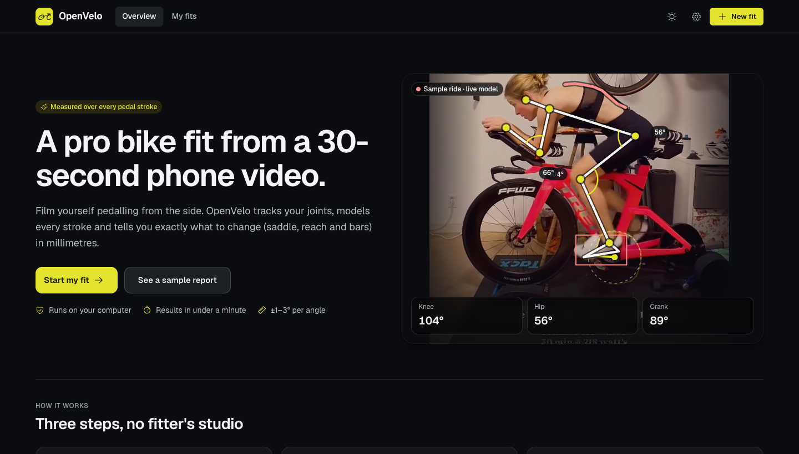
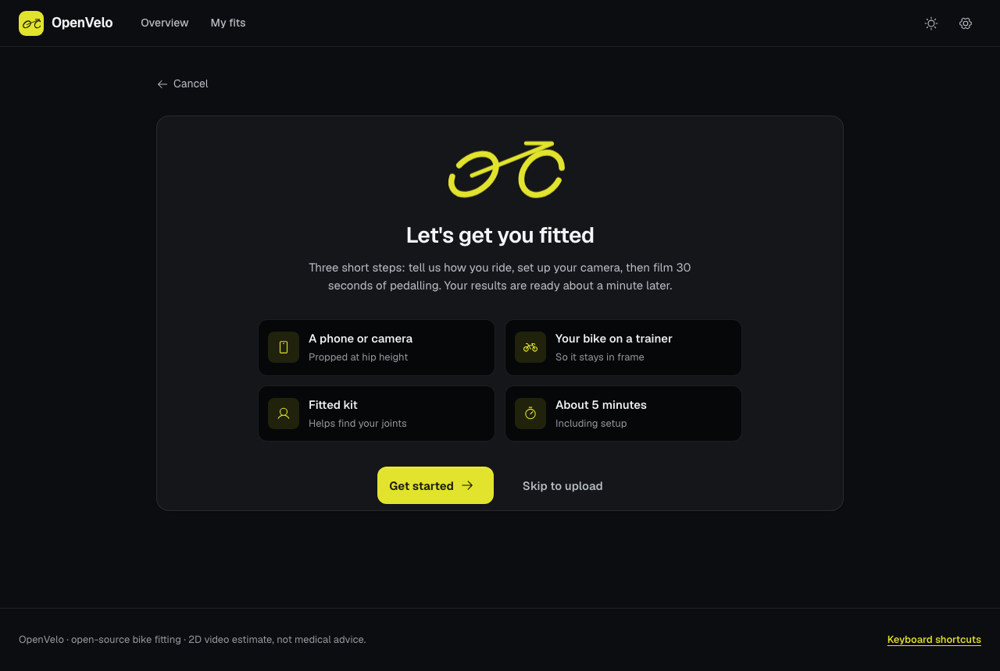
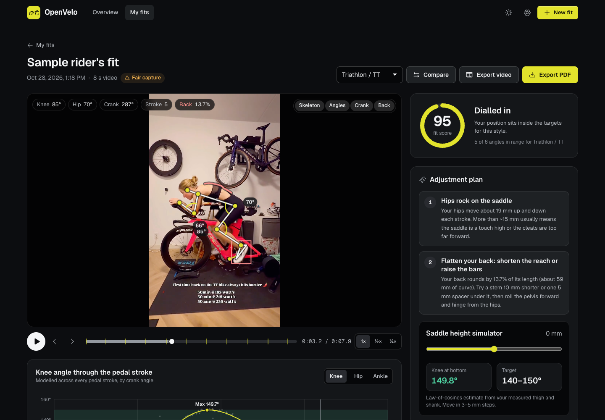

<p align="center"></p>

# OpenVelo: open-source bike fitting


**OpenVelo** (formerly NintAi) turns a 30-second phone video of you pedalling into a professional bike fit. It tracks your joints, models every pedal stroke, and gives you measured angles with confidence ranges plus a ranked plan of what to adjust: saddle, reach and bars. It runs entirely on your computer, with no AI service or account.



| Guided onboarding | Fit report |
| :---: | :---: |
|  |  |

## What you get

- **Chat-style onboarding.** A fit assistant asks six quick questions (riding style, height, flexibility, discomfort, cranks). Answer in your own words ("5'10\"", "Ironman training", "my knees ache at the front") or tap a suggestion; it all runs offline, with no AI service. Then a camera-setup guide, and either an upload or an in-browser recording with a **live framing check** that confirms you're side-on, in frame and pedalling.
- **Measured angles with confidence.** Knee extension and bend, hip, torso, shoulder and elbow, each reported with a 95% range.
- **A ranked adjustment plan.** Saddle height is given in millimetres when your height is known. A **saddle-height simulator** lets you preview the effect of each change.
- **Interactive report.** Your video plays with the skeleton, joint angles and crank drawn on top. A pedal-stroke chart is synced to playback.
- **History and comparison.** Every fit is saved, so you can compare before and after each adjustment. Export any fit as a PDF.
- **Polished, accessible UI.** Light and dark themes, [Phosphor](https://phosphoricons.com) icons (the free icon set built into Framer), an animated logo for loading states, keyboard shortcuts, and a layout that works down to phone width.
- **Private and offline.** No account, no API key and no cloud service. Video and results stay on your computer.

## Quick start

### 1. Create a conda environment and install the requirements

```bash
git clone -b feat/upgradeapp https://github.com/pgeedh/NintAi-The-AI-Powered-Bike-Fit-Studio.git
cd NintAi-The-AI-Powered-Bike-Fit-Studio

conda create -n openvelo python=3.11 -y
conda activate openvelo
pip install -r requirements.txt
```

Python 3.9–3.12 all work. Without conda, use a virtual environment instead: `python3 -m venv .venv && source .venv/bin/activate`, then `pip install -r requirements.txt`.

> The last two lines of `requirements.txt` install the optional RTMPose engine (`rtmlib`, `onnxruntime`). Remove them for a lighter install; the studio uses the bundled MediaPipe model either way.

### 2. Launch the studio

```bash
python app.py
```

The studio opens at **http://127.0.0.1:8501**. No video yet? Select **See a sample report**, or choose **Use the sample ride** in step 3 of a new fit.

Options: `--port 8600`, `--host 0.0.0.0` (to reach the studio from other devices), and `--no-browser`.

### 3. Record a good video

| Do | Why |
| --- | --- |
| Put the camera exactly side-on (90°) to the bike | Angles are measured in the side-view plane |
| Set the lens at hip height, 2.5–3 m away, in landscape | Keeps the whole bike and rider in frame with little perspective distortion |
| Use bright, even light and fitted clothing | Helps the tracker find your joints |
| Pedal normally for 20–30 s on a trainer, at about 85–95 rpm | Gives 20+ strokes to model |
| Enter your height in step 1 | Converts angles into millimetre adjustments |

The browser camera check needs a secure page. It works at `http://127.0.0.1` on the same computer. Recording from a phone over your network would need HTTPS, so record on the phone instead and upload the file.

---

## How the measurement works

Reading angles frame by frame and taking the maximum (or a median per stroke) has three problems on real phone footage:

1. **Left/right leg swaps.** Side-on, pose models often swap the near and far leg for a few frames. One swap turns a 145° knee into a 70° one.
2. **Sampling aliasing.** At 30 fps and 90 rpm there are only about 20 frames per revolution, so the true peak usually falls between frames.
3. **Noise at the extremes.** Maximum and minimum are the statistics most sensitive to keypoint jitter.

OpenVelo solves all three with this pipeline (implemented in [`src/kinematics.py`](src/kinematics.py)):

```
video → pose keypoints → leg-identity tracking → cleaning → crank angle θ per frame
      → angle(θ) modelled across all strokes → extremes + 95% CI → personalised targets → plan
```

Conventions: image coordinates have *x* to the right and *y* down, in pixels. Crank angle θ is 0° at top dead centre (12 o'clock), 90° forward (3 o'clock) and 180° at bottom dead centre, increasing in the pedalling direction.

### 1. Pose estimation

Each frame is processed by **MediaPipe Pose Landmarker Heavy** (33 landmarks including heel and toe, bundled in `src/models/`), or optionally **RTMPose-m Halpe-26** via `rtmlib`. Every keypoint carries a confidence score. MediaPipe also gives a relative depth *z*, which tells the near-side limbs from the far ones.

### 2. Leg-identity tracking (two-state Viterbi)

For each limb group (knee, ankle, heel, toe; and elbow, wrist), every frame *t* has a hidden state *s<sub>t</sub>* ∈ {0 = labels as given, 1 = labels swapped}. The tracker finds the state sequence that minimises

$$
J = \sum_t \left[ \frac{\lVert A_t(s_t) - A_{t-1}(s_{t-1}) \rVert + \lVert B_t(s_t) - B_{t-1}(s_{t-1}) \rVert}{\bar L_{\text{thigh}}} + \lambda\, s_t \right]
$$

where *A* and *B* are the two limb tracks under each labelling, distances are mean joint displacements, $\bar L_{\text{thigh}}$ normalises for scale, and λ = 0.12 is a small prior that favours the model's own labels. A swap costs two jumps of roughly a crank diameter, so Viterbi repairs it. Normal pedalling motion between frames costs little. The near side is picked from MediaPipe depth (lower *z* is closer), or otherwise from the facing direction.

### 3. Cleaning

- Points below 0.35 confidence are discarded.
- **Hampel filter:** samples more than 3 robust SDs ($1.4826 \cdot \text{MAD}$) from the local median are rejected.
- Gaps up to 0.2 s are linearly interpolated.
- Light **zero-phase Savitzky–Golay** smoothing is applied (≈0.12 s window, order 2).

### 4. Crank geometry and crank angle

The pedal spindle is approximated by the ball of the foot, $\mathbf b = \mathbf{heel} + 0.72\,(\mathbf{toe} - \mathbf{heel})$, which traces the crank circle. The circle $(c_x, c_y, r)$ is fitted robustly:

1. **Seed:** the better (lower median residual) of the algebraic Kåsa fit and a median seed. The median seed takes the coordinate-wise median as the centre and the median distance as the radius, and a full pedal circle can't be dragged by a few wild points.
2. **Trim:** points with residual $\lvert d_i - r \rvert > 3\,\text{MAD}$ are dropped and the seed is re-fitted.
3. **Refine:** Gauss–Newton on the geometric (orthogonal-distance) error with Huber weights, $w_i = \min\left(1, \frac{1.345\,s}{\lvert d_i - r\rvert}\right)$.

The crank angle of each frame is

$$
\theta = \mathrm{atan2}\big(f\,(b_x - c_x),\; -(b_y - c_y)\big) \bmod 360^\circ, \qquad f = \pm 1 \text{ for a rider facing right or left.}
$$

If the unwrapped θ runs backwards, the facing direction was misjudged and *f* is flipped. Cadence is nearly constant within a stroke, so the unwrapped θ is smoothed over ≈0.35 s to remove foot-keypoint jitter.

A second phase estimate comes from the **Hilbert transform** of leg extension (hip–ankle distance): $\varphi = \arg \mathcal H\{d_{\text{hip–ankle}}\}$. It is anchored to true crank angle by the circular-mean offset $\Delta = \mathrm{atan2}\left(\overline{\sin(\theta-\varphi)}, \overline{\cos(\theta-\varphi)}\right)$. OpenVelo then keeps whichever phase explains the knee signal with less scatter (it must be at least 10% better to replace the circle phase). With no usable circle, the Hilbert phase is used alone, with its peak placed at 180°.

**Strokes** are whole revolutions of the unwrapped θ. **Cadence** is the least-squares slope of unwrapped θ against time: $\text{rpm} = \frac{60}{360}\,\frac{d\theta}{dt}$.

### 5. Joint angles (per frame, side view)

| Angle | Definition |
| --- | --- |
| Knee | $\angle(\text{hip}, \text{knee}, \text{ankle})$, where 180° is a straight leg |
| Hip | $\angle(\text{shoulder}, \text{hip}, \text{knee})$ |
| Torso | acute angle of hip → shoulder against the horizontal |
| Shoulder | $\angle(\text{hip}, \text{shoulder}, \text{elbow})$ |
| Elbow | $\angle(\text{shoulder}, \text{elbow}, \text{wrist})$ |
| Ankle | $\angle(\text{knee}, \text{ankle}, \text{toe})$; ankling = its range over the stroke |

Inner angles use $\theta_{ABC} = \arccos\frac{(\mathbf A-\mathbf B)\cdot(\mathbf C-\mathbf B)}{\lVert\mathbf A-\mathbf B\rVert\,\lVert\mathbf C-\mathbf B\rVert}$.

### 6. Crank-angle modelling (robust Fourier regression)

Every frame becomes one sample of angle(θ). Pooling all strokes gives hundreds of samples spread densely around the circle, far denser than any single stroke. Each angle is fitted with a 4-harmonic Fourier series

$$
y(\theta) = a_0 + \sum_{k=1}^{4} \big(a_k \cos k\theta + b_k \sin k\theta\big)
$$

by **iteratively reweighted least squares with Huber weights**, so the occasional bad frame can't pull the curve. The reported values come from the fitted curve, evaluated every 1°:

- **Knee extension** = max of the knee curve; **knee bend** = its min (each reported with the crank angle where it occurs).
- **Closed hip** = min of the hip curve.
- **Torso, shoulder, elbow** = the curve mean, $a_0$.
- **Ankling** = peak-to-peak of the ankle curve.

### 7. 95% confidence ranges (stroke bootstrap)

Whole strokes are resampled with replacement (B = 200), the model is re-fitted, and each statistic is recomputed. The 2.5th–97.5th percentiles give the range shown as ± in the report. Resampling whole strokes, not single frames, respects the correlation between neighbouring frames. On clean side-on footage this typically gives ±0.5–1.5°.

### 8. Millimetre scale and derived quantities

The scale (mm per pixel) comes from:

- **Rider height** (preferred), using Winter's anthropometrics: thigh + shank ≈ 0.491·H, so $s = \dfrac{0.491\,H}{\bar L_{\text{thigh}} + \bar L_{\text{shank}}}$.
- **Crank circle**, $s = \text{crank length}/r$. This is used only if the implied thigh length is anatomically plausible (330–560 mm), because motion blur on shoes shrinks the fitted radius.

With a scale available:

- **Saddle height change.** The leg is treated as a two-link chain (law of cosines): hip–ankle reach is $d(\theta_k) = \sqrt{L_1^2 + L_2^2 - 2L_1L_2\cos\theta_k}$, so $\Delta_{\text{saddle}} = \big(d(\theta_{\text{target}}) - d(\theta_{\text{measured}})\big)\cdot s$. The target is 1.5° inside the nearest edge of your range, and a single change is capped at 15 mm. The in-app simulator inverts the same relation.
- **KOPS** is the horizontal knee-to-spindle offset at θ = 90°, read from its own harmonic model.
- **Hip rock** is the peak-to-peak of the *periodic* part of hip height (from a harmonic fit, so noise isn't counted as rocking).

### 9. Personalised targets and score

Each discipline has published dynamic-fit ranges (table below). These shift with the rider:

- **Limited flexibility:** hip and torso targets +5°. **Flexible:** −3°.
- **Lower-back pain:** hip and torso +3°.
- **Front-of-knee pain:** favour the upper end of knee extension.
- **Back-of-knee pain:** cap over-extension (−3° at the top of the range).
- **Neck, shoulder or hand pain:** shorter reach and a slightly higher front end.

Each angle is graded **In range**, **Close** (within 3°) or **Adjust**. The fit score is a weighted share in range: knee extension ×3, hip ×2, shoulder ×1.5, knee bend and torso ×1, elbow ×0.5, with partial credit for "Close".

### 10. Capture quality grade

Each fit is graded Good, Fair or Poor from:

- detection rate;
- clip length;
- side-on alignment, the ratio of shoulder separation to torso length, which should be ≤ 0.35;
- model scatter, the robust SD of frames around the knee curve, which should be ≤ 3.5°;
- whether a stroke model could be built.

Poor captures get specific advice on how to re-film.

## Riding-style target ranges

| Metric | Endurance road | Race road | Triathlon / TT | Gravel / MTB |
| :--- | :---: | :---: | :---: | :---: |
| Knee extension (max) | 140–150° | 140–150° | 140–150° | 138–148° |
| Knee bend (min) | 65–80° | 65–80° | 65–80° | 65–80° |
| Hip angle (min) | 50–65° | 45–55° | 40–55° | 55–70° |
| Torso vs horizontal | 45–55° | 35–45° | 10–28° | 45–60° |
| Shoulder | 80–95° | 85–100° | 80–100° | 75–90° |
| Elbow | 150–165° | 150–165° | 85–115° | 140–160° |

## Limitations

- These are **2D side-view estimates**, not a medical assessment. Comfort and pain-free riding come first.
- The two pose engines place joints slightly differently (RTMPose's knee extension can read several degrees lower than MediaPipe's on the same clip). Compare fits made with the same engine; the compare view warns when they differ.
- Millimetre values are estimates that depend on the height you enter.

## Command line

```bash
python src/analyze_video.py -i assets/examples/videos/testvideo2.mp4 -p road_race --rider_height 175 -op output/fit.pdf
python src/analyze_image.py -i assets/examples/images/1.jpg -p road_endurance -op output/photo.pdf
python scripts/build_demo.py      # rebuild the bundled sample report
python -m pytest -q               # run the test suite
```

## Project layout

```
app.py                      Launches the studio (FastAPI + Uvicorn)
src/
  kinematics.py             Leg tracking, crank angle, Fourier models, bootstrap CIs
  engine.py                 Video/photo analysis pipeline and scoring
  pose_backends.py          MediaPipe and RTMPose adapters
  fit_profiles.py           Target ranges, personalisation, recommendations
  report.py · coach.py      PDF report and plain-language coach notes
  web/app.py                REST API: background jobs, saved fits, media, PDF
  web/static/               The studio UI (HTML, CSS, ES modules; no build step)
assets/demo/                Pre-computed sample fit shown on first launch
assets/examples/            Sample videos and photos
scripts/build_demo.py       Regenerates assets/demo
tests/                      Unit tests for the maths, scoring and reports
```

Saved fits live in `output/sessions/` (git-ignored).

## Brand

The logo is a single-stroke bicycle in signal yellow `#E2E32C` on ink `#171706`. The SVG mark lives in [`src/web/static/favicon.svg`](src/web/static/favicon.svg) and as the `logo-bike` symbol in `index.html`; an animated stroke version (`js/logo.js`) draws itself in on launch and "rides" during loading.

OpenVelo is an independent open-source project and is not affiliated with MyVeloFit or Retül.

## License

MIT. Created with love for the passion of triathlon by **Pruthvi**.
